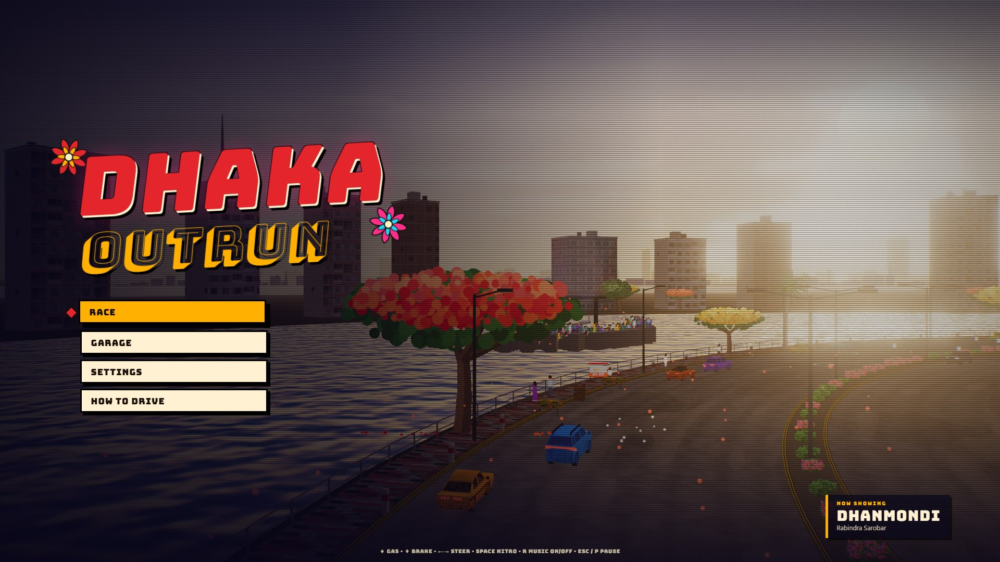
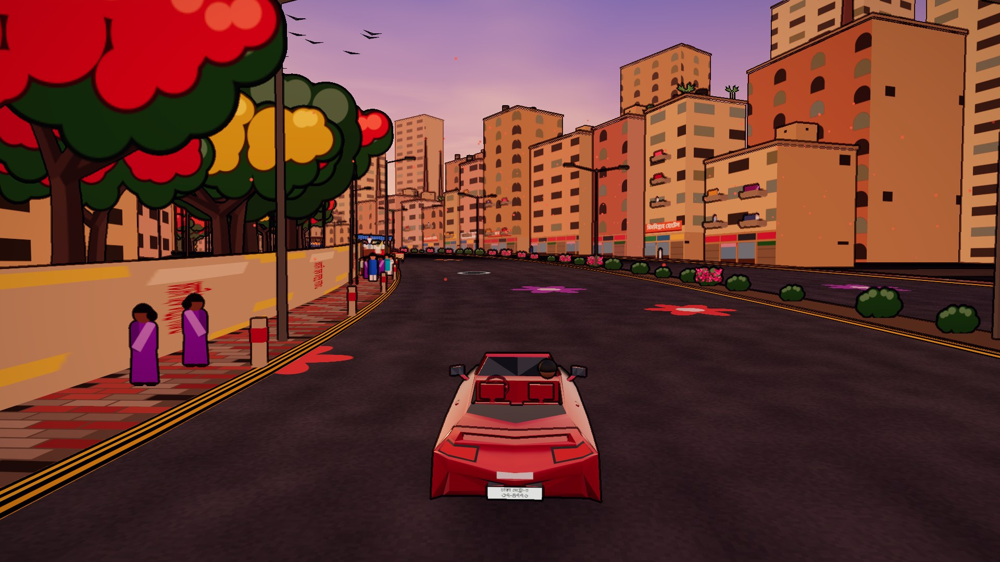
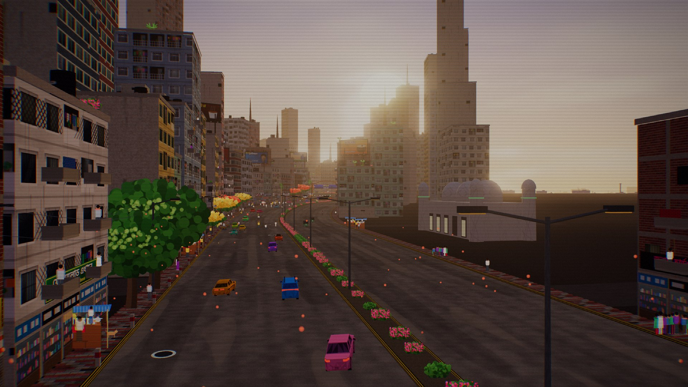
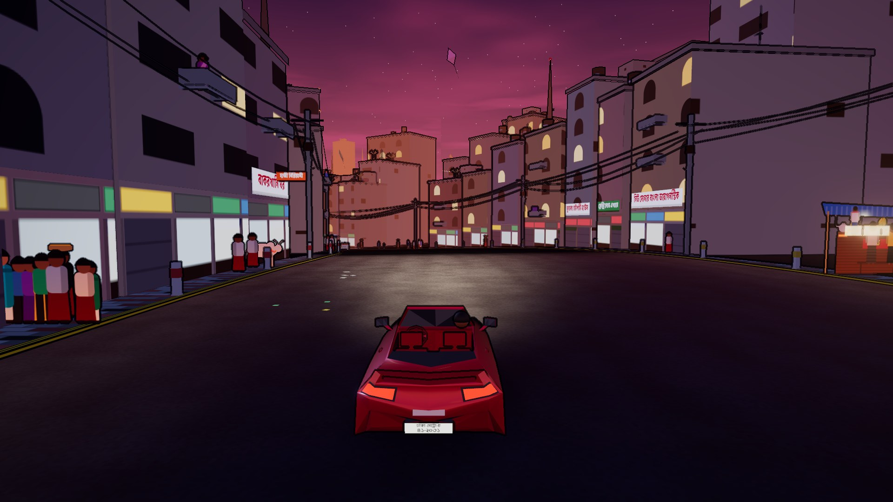
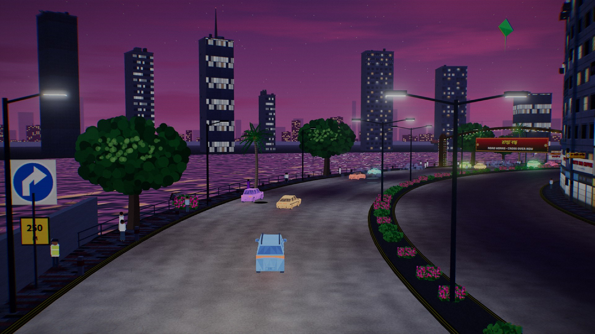
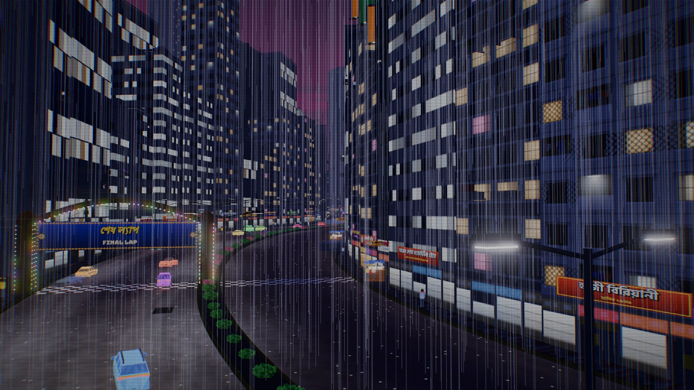
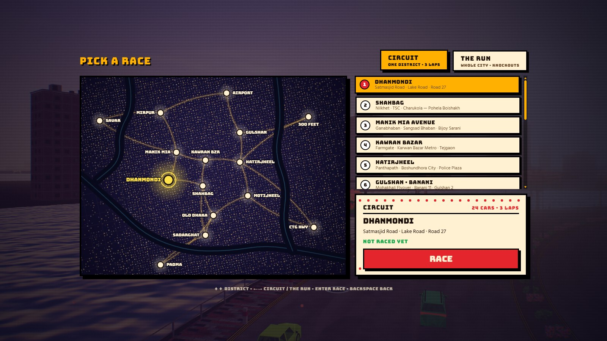

# Outrun Dhaka

An arcade racer through Dhaka, after Horizon Chase Turbo. Race any of fifteen districts as a three-lap circuit, or run **The Run**: a knockout race across the whole city, from Dhanmondi at dusk to the Padma Bridge at dawn.

Runs in the browser. No install, no assets to download: the world, the music and the engine sounds are all generated in code, in about 2 MB.



| | |
|---|---|
|  |  |
|  |  |
|  |  |

## Play

- **Quickest:** build it (below) and open `dist/index.html` in Chrome or Edge. It is one self-contained file. Fonts load from Google Fonts when online.
- **Dev server:** `npm install`, `npm run dev`, then open http://127.0.0.1:5173

Controls: ↑/W gas · ↓/S brake · ←→ steer · SPACE/B nitro · R music · ESC/P pause · F fullscreen. Gamepads work. On a phone, gas is automatic: two steer buttons on the left, brake and nitro on the right.

## The game

- **Circuit:** any district, three laps, 24 cars. You start last with the field strung out ahead, so you pass a few at a time. Gold, silver and bronze times; your best time and medal are saved per race.
- **The Run:** 48 cars on one road through every district. Knockout gates thin the field at Shahbag, Kawran Bazar, Gulshan, Sadarghat, Mirpur and 300 Feet. About five minutes.
- **Driving:** corners push you wide, so the skill is the line you hold. Tap nitro to burn a charge (hold three), but nitro in a bend throws you wide. The verge and rails cost speed and grip. Fuel cans, coins and nitro pickups lie across the road; the tank is a bit under a circuit's worth, so fuel is something you manage.
- **The road:** rickshaws, CNGs, buses, police and RAB pickups, pedestrians and stalls. Nobody keeps to a lane. Anything you hit is flung off the road. Potholes, patches and litter that scatters when you drive through it; in the rain, puddles that splash, umbrellas and water beading on the car. On divided roads, stretches of ROAD WORKS push you onto the opposite carriageway, against oncoming traffic.
- **The places:** each district has its own time of night, weather, music and real landmarks (Jatiya Sangsad Bhaban, Ahsan Manzil, Baitul Mukarram, Shaheed Minar and more), plus the metro train on its viaduct, planes over the airport, kites and fireworks.
- **Sound:** original music on Bengali scales with tabla, bansuri and ektara, a different track per district, and a modelled engine sound.

Dhanmondi → Shahbag → Manik Mia → Kawran Bazar → Hatirjheel → Gulshan → Old Dhaka → Sadarghat → Motijheel → Mirpur → Airport Road → 300 Feet → CTG Highway → Savar → Padma Bridge

## Build

```
npm install
npm run build      # dist/index.html, a single file
npm run artifact   # also dist/outrun-dhaka.artifact.html (no document skeleton)
```

Built with [three.js](https://threejs.org) and Vite. Deployed as a static site (see `render.yaml`).

### Optional recordings and models

The game ships with generated sound and buildings. If you add files, it uses them instead; any that are missing fall back to the generated version.

- `public/audio/` loopable `rain`, `city` and `river` recordings (`.ogg` or `.mp3`). See [public/audio/README.txt](public/audio/README.txt).
- `public/models/` glTF binaries named after a landmark (`sangsad.glb`, `ahsanManzil.glb`, ...). See [public/models/README.txt](public/models/README.txt).

When using these, the build is a folder (`dist/`), not just one file.

## Code map

- `src/world/` track geometry, districts (`stages.js`), chunk streaming, props, landmarks, textures, sky, road shader
- `src/game/` driving model (`player.js`), races and rivals (`race.js`), traffic, pedestrians, instanced cars (`fleet.js`), ambience, showreel (`attract.js`), weather, camera
- `src/audio/` synthesised engines and effects, the music sequencer
- `src/ui/` HUD, menus, the Dhaka map

## Credits

- Car meshes: "Free Low Poly Vehicles Pack" by Rgsdev, CC0 (`src/assets/cars/LICENSE.txt`). Refitted, recoloured and smooth-shaded at startup.
- Everything else (art, music, sound, code) is original.

## License

Code: MIT, see [LICENSE](LICENSE).
