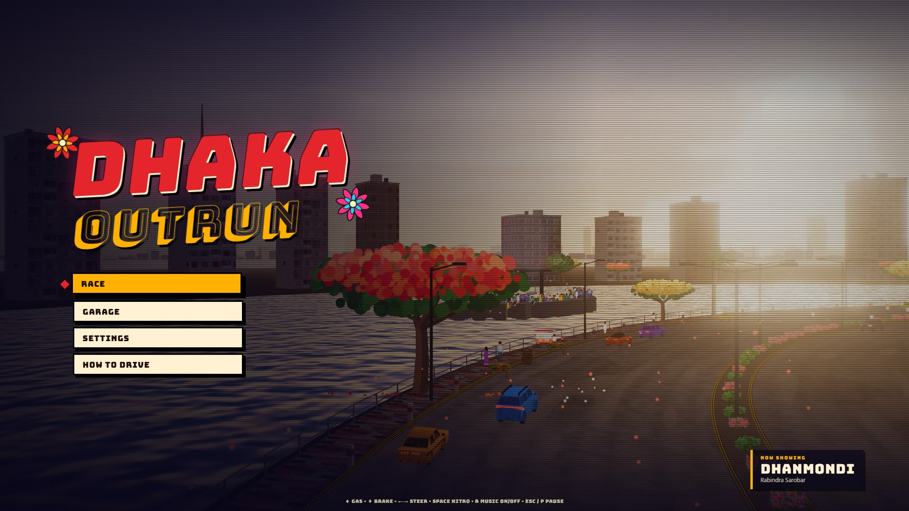
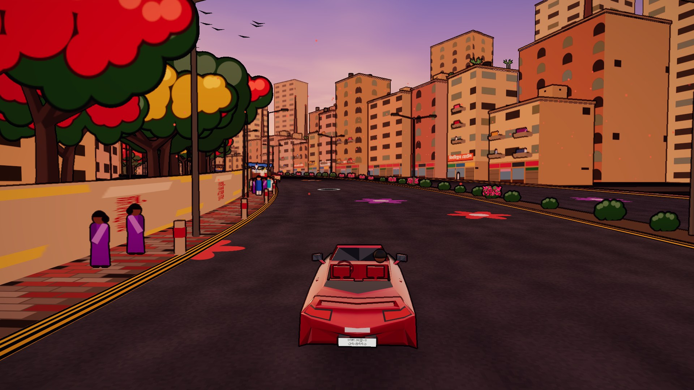
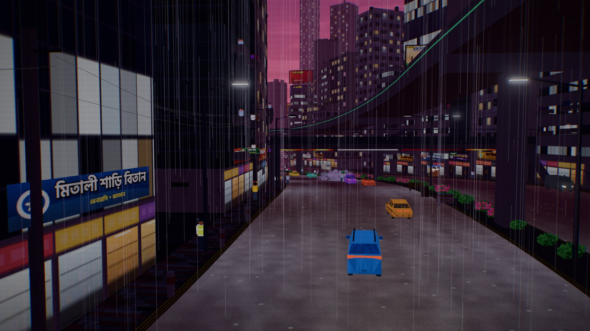
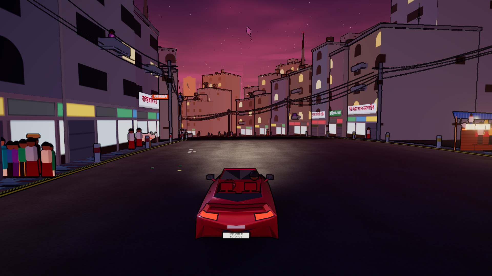
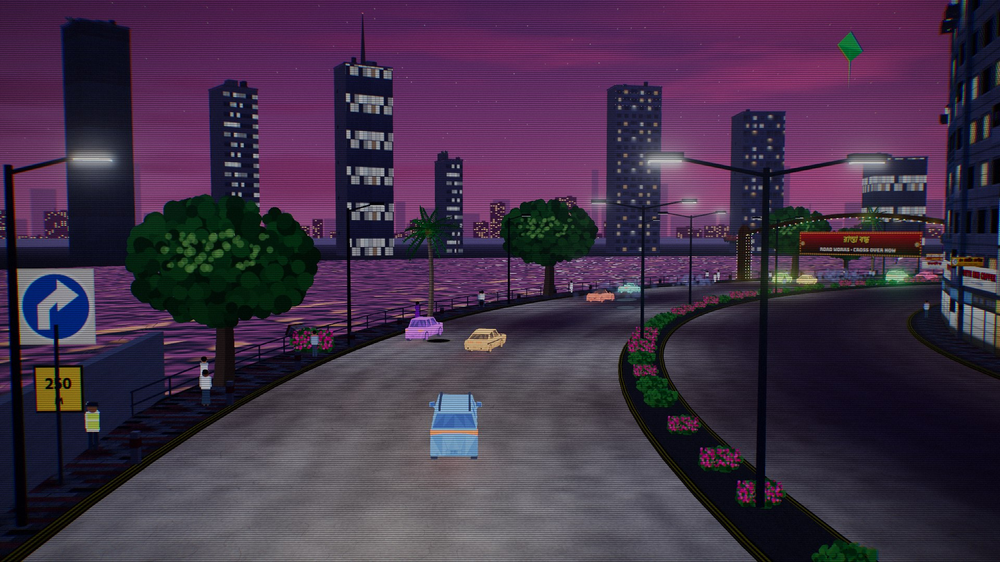
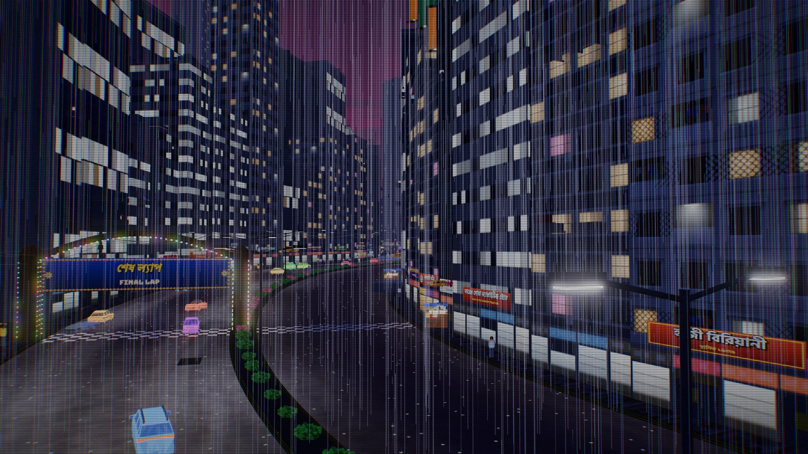
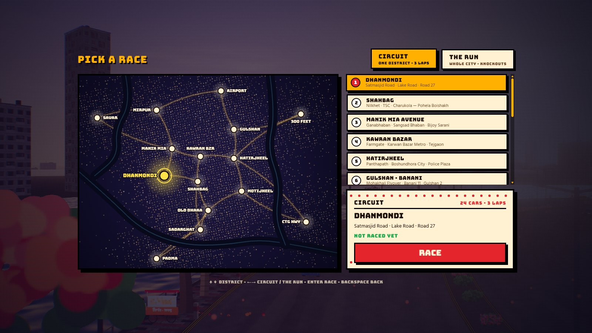

# Outrun Dhaka

An arcade racer through Dhaka, after Horizon Chase Turbo. Race any of fifteen districts as a three-lap circuit, or run **The Run**: a knockout race across the whole city, from Dhanmondi at dusk to the Padma Bridge at dawn.

Runs in the browser. No install, no assets to download: the world, the music and the engine sounds are all generated in code, in about 2 MB.



| | |
|---|---|
|  |  |
|  |  |
|  |  |

## Play

- **Play now:** https://hal0mg.github.io/outrun-dhaka/ (runs in your browser, nothing to install; Chrome or Edge works best).
- **Windows:** download `OutrunDhaka.exe` from the [latest release](https://github.com/Hal0MG/outrun-dhaka/releases/latest) and run it. (Windows may warn that the file is unsigned: More info, then Run anyway.) Or build it yourself with `npm run exe`.
- **Any browser:** build it (below) and open `dist/index.html` in Chrome or Edge. It is one self-contained file. Fonts load from Google Fonts when online.
- **Dev server:** `npm install`, `npm run dev`, then open http://127.0.0.1:5173

Controls: ↑/W gas · ↓/S brake · ←→ steer · SPACE/B nitro · R music · ESC/P pause · F fullscreen. Gamepads work. On a phone, gas is automatic: two steer buttons on the left, brake and nitro on the right.

## The game

- **Circuit:** any district, three laps, 24 cars. You start last with the field strung out ahead, so you pass a few at a time. Gold, silver and bronze times; your best time and medal are saved per race.
- **The Run:** 48 cars on one road through every district. Knockout gates thin the field at Shahbag, Kawran Bazar, Gulshan, Sadarghat, Mirpur and 300 Feet. About five minutes.
- **Driving:** corners push you wide, so the skill is the line you hold. Tap nitro to burn a charge (hold three), but nitro in a bend throws you wide. The verge and rails cost speed and grip. Rows of nitro lie across the road, and every eighth car you pass earns another charge.
- **The road:** rickshaws, CNGs, buses, police and RAB pickups, pedestrians and stalls. Nobody keeps to a lane. Anything you hit is flung off the road. Potholes, patches and litter that scatters when you drive through it; in the rain, puddles that splash, umbrellas and water beading on the car. On divided roads, stretches of ROAD WORKS push you onto the opposite carriageway, against oncoming traffic.
- **The places:** each district has its own time of night, weather, music and real landmarks (Jatiya Sangsad Bhaban, Ahsan Manzil, Baitul Mukarram, Shaheed Minar and more), plus the metro train on its viaduct, planes over the airport, kites and fireworks.
- **Sound:** original modern electronic music (future house, moombahton, melodic techno, UK garage, liquid drum & bass) on Bengali ragas, with tabla, bansuri and ektara as the hooks, a different track per district. Every car has its own modelled engine: the Supra's twin-turbo six, the Skyline's RB26 with its flutter, the Miata's unboosted four, the CNG's two-stroke, with turbo spool, whistle and blow-off. Around the road: horns, rickshaw bells, street sellers' calls, dogs and songs leaking from shop radios, busier in the busy districts.
- **Cars:** pick your car and colour on the race card before each race. Every car drives the same; only the body and the sound differ.

Dhanmondi → Shahbag → Manik Mia → Kawran Bazar → Hatirjheel → Gulshan → Old Dhaka → Sadarghat → Motijheel → Mirpur → Airport Road → 300 Feet → CTG Highway → Savar → Padma Bridge

## Build

```
npm install
npm run build      # dist/index.html, a single file
npm run artifact   # also dist/outrun-dhaka.artifact.html (no document skeleton)
npm run exe        # dist/OutrunDhaka.exe, a 2 MB Windows launcher (see below)
```

Built with [three.js](https://threejs.org) and Vite. Deployed as a static site (see `render.yaml`).

### Windows exe

`npm run exe` builds `dist/OutrunDhaka.exe`: one 2 MB file with the game inside. It opens the game in its own Edge app window (no tabs or address bar), so there is no Electron and nothing to install: Edge ships with Windows 10 and 11 (Chrome is used if Edge is missing). It is built with the C# compiler that comes with Windows; the source is `tools/launcher/Launcher.cs`. Settings and best times are kept in `%LOCALAPPDATA%/OutrunDhaka`.

### Optional recordings and models

The game ships with generated sound and buildings. If you add files, it uses them instead; any that are missing fall back to the generated version.

- `public/audio/` loopable `rain`, `city` and `river` recordings (`.ogg` or `.mp3`). See [public/audio/README.txt](public/audio/README.txt).
- `public/models/` glTF binaries named after a landmark (`sangsad.glb`, `ahsanManzil.glb`, ...). See [public/models/README.txt](public/models/README.txt).

When using these, the build is a folder (`dist/`), not just one file.

## Code map

- `src/world/` track geometry, districts (`stages.js`), chunk streaming, props, landmarks, textures, sky, road shader
- `src/game/` driving model (`player.js`), races and rivals (`race.js`), traffic, pedestrians, instanced cars (`fleet.js`), ambience, showreel (`attract.js`), weather, camera
- `src/audio/` synthesised engines and effects, the music sequencer
- `src/ui/` HUD, menus, the Dhaka map

## AI driver

The game's driving model and race also run with no graphics, in Node: a full three-lap race against the field takes about 120 ms (15 ms alone). `sim/` wraps it as an environment for training AI drivers, and `ml/` trains them with reinforcement learning (PPO, via Stable-Baselines3).

- `sim/env.mjs` builds a district circuit with the game's own track code and steps the real `Player` and `Race`: the 23 rivals, contact, nitro rows and nitro for passes. No traffic, pedestrians or stalls, on purpose: in the game they never slow a racer (a car or stall you hit is flung off the road and costs nothing; only potholes take a sliver of speed), so they would change what the road looks like to a driver and not how it drives. Races are seeded, so the same seed replays exactly.
- `sim/baseline.mjs` (`npm run sim:baseline`) is the hand-written driver to beat: flat out, steer against the corner push (curvature × speed²), nitro on straights, and no attention to the other cars. `--solo` races it alone.
- `ml/outrun_env.py` is the Gymnasium environment (one Node process per env, JSON over stdin/stdout).
- `ml/train.py` races the field from a grid moved to a random point on the lap. Train in two stages: alone first, then the field from there (`--init`). Thrown straight in with the rivals, it learns to sit behind them at their pace and never pass. Gulshan, Old Dhaka and Padma are held out, to tell driving from memorising tracks.
- `ml/evaluate.py` races every district, writes `results.csv`, and for each district a telemetry CSV (line, speed, inputs per decision) and a chart.

```
python -m venv ml/.venv
ml/.venv/Scripts/pip install -r ml/requirements.txt    # macOS/Linux: ml/.venv/bin/pip
cd ml
../ml/.venv/Scripts/python train.py --solo --steps 1500000 --name solo
../ml/.venv/Scripts/python train.py --init solo --steps 2500000 --name field
../ml/.venv/Scripts/python evaluate.py --name field
```

Judge drivers by finishing place first. Racing alone, the medal times are easy: the baseline takes gold on most districts. Against the field the baseline wins 2 of 15 (mean place 11.5 of 24); the two-stage driver above wins 10 (mean place 2.6) and takes gold in 13, in about seven minutes of training.

The opposite carriageway is closed in the sim outside ROAD WORKS (`openOpposite` in `sim/env.mjs`): the game lets you drive it and pays nitro for the wrong way, but the scripted rivals never do, so a rival that did would look wrong; and the first driver trained without that rule learned to race on the empty side. Inside the works the coned-off lane is rough and the way out is across the kerb onto the opposite carriageway, which takes starting early. The driver sees how far off the works are, whether it is in them and where the opposite carriageway starts, and the reward charges for staying in the coned-off lane. Without that it never learned the crossover; with it, `coned_s` in `results.csv` is about zero in every district.

### Trained drivers as rivals

A trained driver is a small network (two layers of 256, about 83,000 weights, 0.8 MB as JSON) that runs in plain JavaScript, about 75 µs a decision, so 23 of them cost under 3% of a core.

```
cd ml && ../ml/.venv/Scripts/python export.py --name field     # weights, plus states to check against
cd .. && node sim/brain-check.mjs ml/runs/field                # JavaScript against Python: 111 states, largest difference 2e-5
node sim/rivals.mjs ml/runs/field/brain.json --learned 5       # the five front-runners are learned, in every district
```

- `sim/brain.mjs` is the network in JavaScript. `sim/env.mjs` takes `learned` and `brain` options: that many front-runners (the leader first) become a real `Player` driven by the network, held to the pace their scripted selves run, with no nitro. Everything else in `Race` (contact, standings, passes) treats them as ordinary rivals. If one is ever stopped for a second (a network at rest on the road is something it has never seen), it drives itself for four seconds, floored and steering for the middle; the final driver never needs it.
- `sim/rivals.mjs` races the same stand-in player against the scripted field and the learned one.

What it shows (the two-stage driver above): all five learned front-runners finish every district at the scripted pace (100.3 s on average against 100.7 s), spend no time off the road and never scrape a wall. A stand-in player finishes within a few places of where it does against the scripted field. Not done yet: the rest of the field, rivals that race each other rather than the scripted ones, a skill setting instead of the copied pace, and the game itself.

### In the game

The RIVALS row in the settings menu picks who drives the rivals: SCRIPTED (the default), AI FRONT RUNNERS (the five at the front) or AI ALL, from the next race start. `?ai=5` or `?ai=all` in the address does the same and wins over the setting. If the weights fail to load the race is the scripted one. The weights are `public/ai/brain.json` (0.8 MB, the circuit driver `road-2-field`). The game and the sim run the same code: `src/game/learned.js` holds the observation, the lane and mistake variety and the driving, `src/game/brain.js` the network; `sim/env.mjs` attaches it to the sim's race the way `src/game/game.js` attaches it to the game's, so what is measured in the sim is what plays. Each learned rival is a real `Player` that decides 15 times a second whatever the frame rate, and its rival entry stays the truth for contact, standings and knockouts. Checked in the game with the browser pane: 5 learned rivals race Dhanmondi at about 325 km/h with no time off the road, and a Run with all 47 learned costs about 1.5 ms a frame on top of the game.

In The Run their pace ramps with the district, from 0.96 of the scripted skill in Dhanmondi to 1.0 in Padma, so the early knockouts stay easy and the later ones are a harder fight (a first playtest led by Airport Road at a flat 0.97). With all 47 learned the simple driver finishes 11th on median, with margins at the last three gates of 11 to 13 where a flat 0.97 gave 12 to 16; 7 of 8 finish. The ramp is `RUN_PACE` in `src/game/learned.js`.

Not done: nobody has played against them yet (whether they are fun is the open question), it is off by default, and the leaders of The Run, further up the road than the loaded district, run at their pace without physics, as the scripted ones do.

### The Run

`mode: 'run'` in `sim/env.mjs` (`OutrunEnv(mode="run")` in Python) lays all fifteen districts end to end, as the game does while you drive, with the 48-car field and the six knockout gates. The episode ends at the flag or where the player is knocked out. Rivals are scripted for now. The driver also sees the next gate: how far off, its cut, and how far past the cut it is.

```
node sim/run.mjs --runs 100                                      # the simple driver, gate by gate
node sim/run.mjs --runs 100 --brain ml/runs/field/brain.json     # a trained driver
node sim/run.mjs --sweep 0.88,0.92,0.96,1 --runs 30              # a range of paces
```

A full Run is about 4,800 decisions, 0.3 s of real time. Over 100 runs each, the simple driver and the driver trained on circuits (never on The Run) get through every gate every time, finishing 7th and 3rd on median. Where the knockouts bite is below that. The sweep holds the simple driver to a fraction of top speed with no nitro, as a stand-in for a player who is not as fast; it shows the share of 30 runs still in after each gate:

| pace | Shahbag | Kawran Bazar | Gulshan | Sadarghat | Mirpur | 300 Feet | finished |
|---|---|---|---|---|---|---|---|
| 88% | 0% | 0% | 0% | 0% | 0% | 0% | 0% |
| 90% | 13% | 0% | 0% | 0% | 0% | 0% | 0% |
| 92% | 97% | 0% | 0% | 0% | 0% | 0% | 0% |
| 94% | 97% | 77% | 0% | 0% | 0% | 0% | 0% |
| 96% | 100% | 100% | 93% | 83% | 80% | 73% | 73% |
| 100% | 100% | 100% | 100% | 100% | 100% | 100% | 100% |

Each gate asks for more pace than the one before: about 91% of top speed to get past Shahbag, 94% for Kawran Bazar, and at 96% a quarter of runs still go out later on (median finish 23rd, the last place that stays in at the final gate). The pace is a cap on speed, not an average, so bends cost a real player more. The cut-offs and the rivals' pace (`KNOCKOUTS` in `stages.js`, `skill` in `race.js`) are the dials.

**Learned rivals in The Run.** `--rivals ml/runs/<name>/brain.json --learned K` drives the K front-runners with a trained network; each is placed on whichever district's road its distance along the route puts it, so they cross forks like the player. With 5 learned, the simple driver finishes 20/20 at a median of 7th (mean 320.2 s), the same as against the scripted field. With all 47 learned it still finishes 20/20, but at 13th, and the margin at every gate is the same in every run (tightest equals mean): the learned cars never make a mistake, so the field is tighter and every race is the same. Two changes fix that. The learned rivals now do what the scripted ones do besides drive: the car right behind the player pushes to hold it off (up to +4%), every 5 to 14 s one runs wide in a bend and lifts for a second, and each keeps half of the scripted lane bias (the network is shown a road shifted sideways, so it steers for its own lane). And because a field of learned cars is tougher than the scripted one (no leash, bends at the grip limit), their pace is 0.97 of the scripted skill in The Run (`learnedPace`). Over 8 runs with all 47 learned, the simple driver finishes 7th on median and the gate margins run from 6 at Shahbag to 13 at Purbachal, against 5 to 16 for the scripted field, and they differ from run to run (tightest 2 to 9). Without the 0.97, the median is 14th and one run in eight goes out at Gulshan; at 0.95 it is 5th. It costs about 180 decisions a second in the sim with all 47 learned, against 2,100 with 5.

**Retraining on the 68-number observation** (`train.py --run-envs K` makes K of the envs race The Run): solo 1.5M decisions, the field 2.5M with 2 Run envs, then 2M more with 4. It is no better than the circuit driver it replaces. On circuits it wins 7 of 15 (the old one 10); in The Run it finishes 5th on median (the old one 3rd), clearing every gate 30 of 30 times; and as a rival its front five take 102.8 s against 100.8 scripted, 0.8 s off the road (the old driver: 101.0 s, 0.2 s). Another 4M decisions made it worse (109.5 s, 5.4 s off the road), so more PPO steps on the same recipe is not the fix. Until a recipe beats it, the circuit driver (64 inputs; `sim/brain.mjs` ignores the extra numbers) stays the rival driver, and it already drives all 47 rivals through The Run.

## Credits

- Car meshes: "Free Low Poly Vehicles Pack" by Rgsdev, CC0 (`src/assets/cars/LICENSE.txt`). Refitted, recoloured and smooth-shaded at startup.
- Everything else (art, music, sound, code) is original.

## License

Code: MIT, see [LICENSE](LICENSE).
